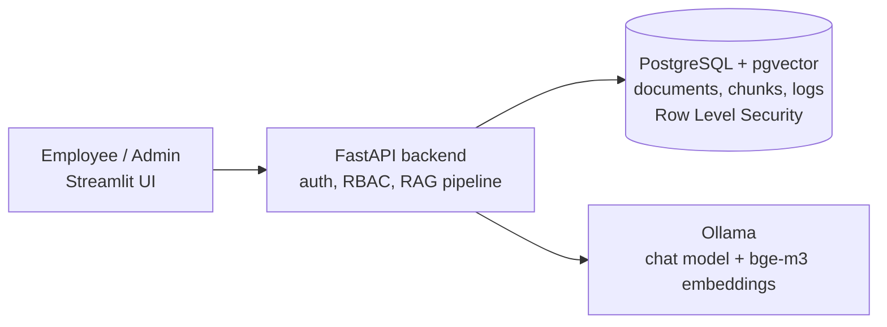

# Offline RAG Assistant

> 🚧 **Work in progress** – planned completion: November 2026

A fully local, offline-capable company knowledge assistant. Employees ask questions about internal policies (organizational rules, IT security policy, HR documents) and get answers **with source references** – without any data leaving the company network.

## Why local?

Cloud-based chatbots send every question and every uploaded document to an external provider. For internal policies and security documents this is often unacceptable. This project runs the language model, the vector database and the application entirely on the company's own hardware.

## Planned features

- [ ] Local LLM inference with Ollama (no internet required)
- [ ] Document ingestion (PDF, DOCX): parsing, chunking, embeddings
- [ ] Retrieval-Augmented Generation with source citations and "I don't know" fallback
- [ ] Role-based access control enforced **at database level** (PostgreSQL Row Level Security), not in the prompt
- [ ] Usage logging and user feedback (helpful / not helpful)
- [ ] Admin dashboard: usage statistics, response times, unanswered questions, denied access attempts
- [ ] Evaluation suite: retrieval hit rate, answer correctness, permission-leak tests
- [ ] One-command start with Docker Compose

## Architecture (planned)

## Tech stack

Python · FastAPI · Streamlit · PostgreSQL + pgvector · Ollama · Docker

## Model selection

Tested on 10 Hungarian policy questions with a fixed context (see `scripts/model_test.py`).
Hardware: NVIDIA RTX 4070 Ti Super (16 GB VRAM), AMD Ryzen 7 7800X3D, 32 GB RAM.

| Model | Score (max 20) | Avg. speed (tokens/s) | Notes |
|-------|----------------|-----------------------|-------|
| gemma4:12b | 20 | 1.0s (144) | Passed both hallucination traps (Q9, Q10) |
| qwen2.5:14b | 18 | 0.8s (65) | Lost points on: Q_10 |

**Decision:** Gemma4:12B - highest accuracy, scored better because of the precise answers. Althought the modell took more time and tokens to answer, it is still the better modell for being a RAG assistant.

## Data notice

All documents in this repository belong to a **fictional company ("Példa Kft.")** and were generated for demonstration purposes. No real company data is used.

## Roadmap

- **Week 1:** environment, model selection, Docker setup, document ingestion, RAG pipeline, API
- **Week 2:** users and roles, Row Level Security, permission-leak tests, chat UI, logging
- **Week 3:** admin dashboard, evaluation suite, offline test, documentation, demo video

Day 2: PostgreSQL 17 + pgvector 0.8.7 in Docker, bge-m3 embeddings verified (1024 dimensions, semantic similarity sanity check passed).

Day 3: Synthetic test dataset (4 policy documents, PDF + DOCX), role-based access matrix, canary facts for leak tests, 25-question evaluation set.